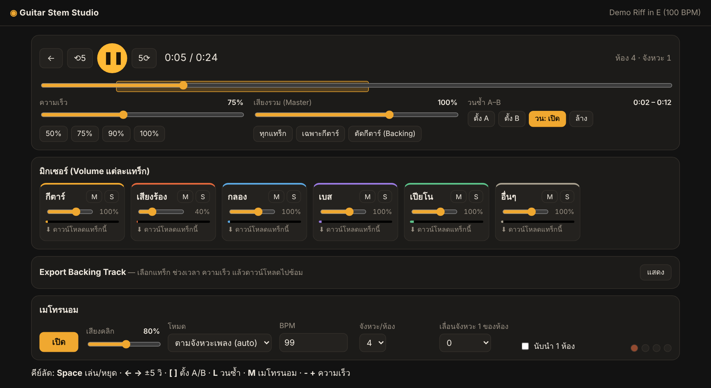
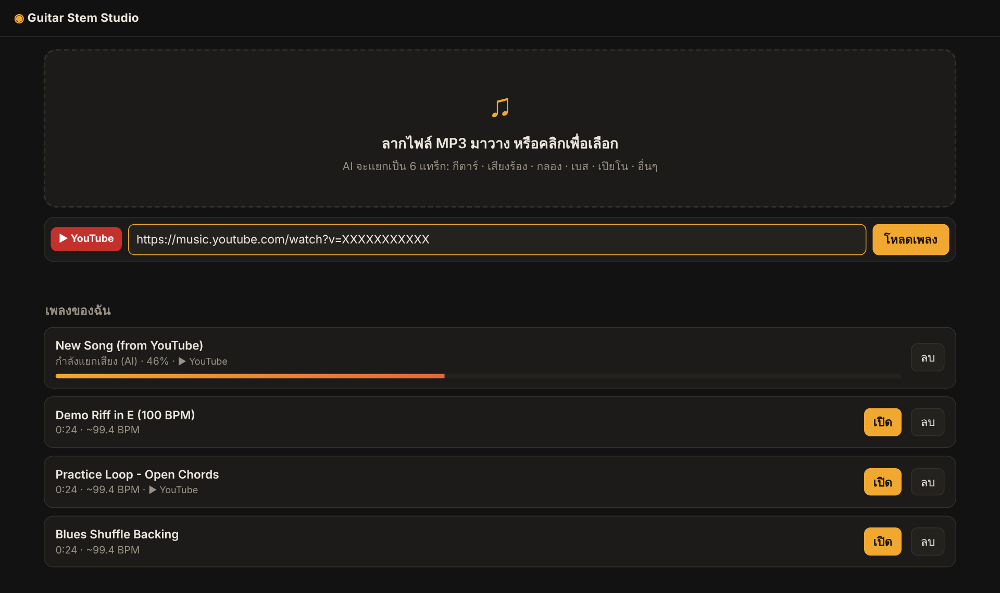
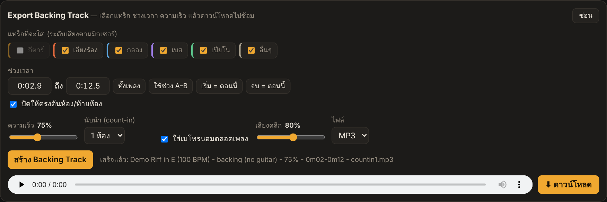
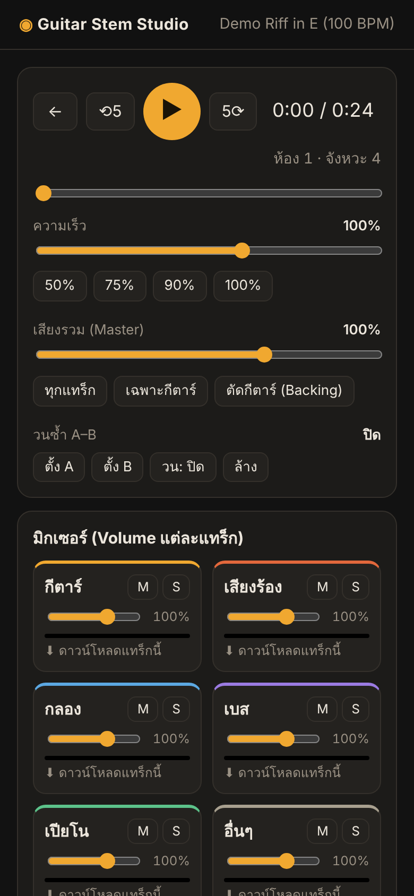

# 🎸 Guitar Stem Studio

**English** · [ภาษาไทย](README.th.md)

A local web app for practicing guitar along with real songs. Drop in an MP3 or paste a YouTube link. AI splits the song into 6 stems (guitar, vocals, drums, bass, piano and other) so you can mute the guitar and play it yourself. You can also slow the song down, loop a section, add a metronome that follows the song, and export a backing track for practice.

Everything runs on your own machine. No audio is uploaded anywhere (except the YouTube download itself).



## Features

| | |
|---|---|
| **Stem separation** | 6 stems with [Demucs](https://github.com/facebookresearch/demucs) `htdemucs_6s`. Each stem can be downloaded. |
| **Mixer** | Per-stem volume, mute and solo, plus level meters. One-click presets: *All*, *Guitar only* and *No guitar (backing)*. |
| **Slow down** | 25%–150% playback speed with pitch preserved. |
| **A–B loop** | Loop any section; set the points with buttons or the `[` `]` keys. |
| **Metronome** | Follows the song's real beats (beat tracking snapped onto the drum hits), or uses a fixed BPM. Choose beats per bar, shift beat 1, and add an optional 1-bar count-in. |
| **Backing track export** | Pick stems (guitar off by default) and a time range (or the A–B loop), set the speed, add a 1–2 bar count-in and an optional metronome, then download MP3 or WAV. Clicks are compensated for time-stretch latency so they land on the drums. |
| **YouTube / YouTube Music** | Paste a link and the song is downloaded and processed automatically ([yt-dlp](https://github.com/yt-dlp/yt-dlp) with a bundled ffmpeg). |

### Library: upload an MP3 or paste a YouTube link


### Backing track export


<details>
<summary>Mobile layout</summary>


</details>

> The UI is currently in Thai.

## Install

Requires **Python 3.10 – 3.13** (3.11 or 3.12 recommended).

```bash
git clone https://github.com/un4ckn0wl3z/guitar-stem-studio.git
cd guitar-stem-studio
```

| | First-time setup | Run |
|---|---|---|
| **Windows** | double-click `setup.bat` | `run.bat` |
| **macOS / Linux** | `./setup.sh` | `./run.sh` |

Then open **http://localhost:8000**.

- The first separation downloads the Demucs model (~80 MB).
- On CPU, a 4-minute song takes roughly 3–8 minutes. An NVIDIA GPU is much faster: install the CUDA build of PyTorch from [pytorch.org](https://pytorch.org/get-started/locally/).
- YouTube changes often. If downloads start failing, run `update.bat` / `./update.sh`.

<details>
<summary>Manual install</summary>

```bash
python -m venv .venv
source .venv/bin/activate          # Windows: .venv\Scripts\activate
pip install -r requirements.txt
python app.py
```
</details>

## Practice workflow

1. Load a song and wait for it to finish processing.
2. Press **No guitar (backing)** to mute the guitar stem.
3. Set an A–B loop around the part you're learning and drop the speed to 50–75%.
4. Turn on the metronome, optionally with a 1-bar count-in.
5. Speed back up as you get it, or **Export Backing Track** to practice away from the computer.

## Keyboard shortcuts

`Space` play/pause · `← →` ±5 s · `[` `]` set A/B · `L` toggle loop · `M` metronome · `-` `+` speed

## Configuration

| Env var | Default | |
|---|---|---|
| `GS_PORT` | `8000` | Port |
| `GS_HOST` | `127.0.0.1` | Set to `0.0.0.0` to use the app from a phone on the same LAN |
| `GS_DEVICE` | auto | `cuda` / `cpu` |
| `GS_STEM_FORMAT` | `mp3` | `wav` for lossless stems |
| `GS_MAX_MINUTES` | `20` | Maximum YouTube video length |
| `GS_DATA_DIR` | `./data/jobs` | Where songs and stems are stored |

## Project layout

```
app.py          FastAPI server + REST API
processing.py   Pipeline: download → Demucs separation → beat tracking (snapped to drum hits)
backing.py      Backing-track renderer (mix, time-stretch, count-in, metronome)
static/         Web UI (vanilla JS, Web Audio)
```

## Notes

- Separation quality depends on the mix. The guitar stem is cleanest on rock and pop with distinct guitars. Two guitars playing the same part, or guitar buried under keys, may bleed into *other* or *piano*.
- Use this for personal practice with music you have the right to use. Downloading from YouTube may be against YouTube's Terms of Service.

## Credits

[Demucs](https://github.com/facebookresearch/demucs) · [librosa](https://librosa.org) · [yt-dlp](https://github.com/yt-dlp/yt-dlp) · [FastAPI](https://fastapi.tiangolo.com) · [Rubber Band](https://breakfastquay.com/rubberband/) (via ffmpeg)
