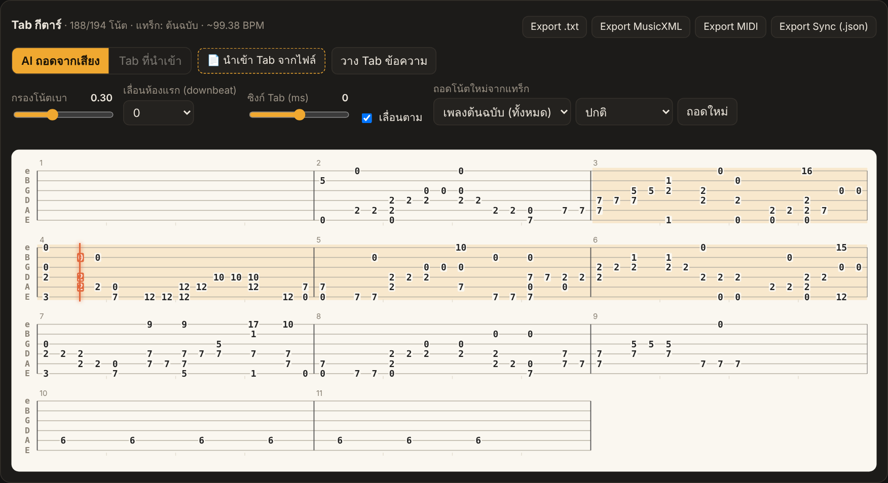
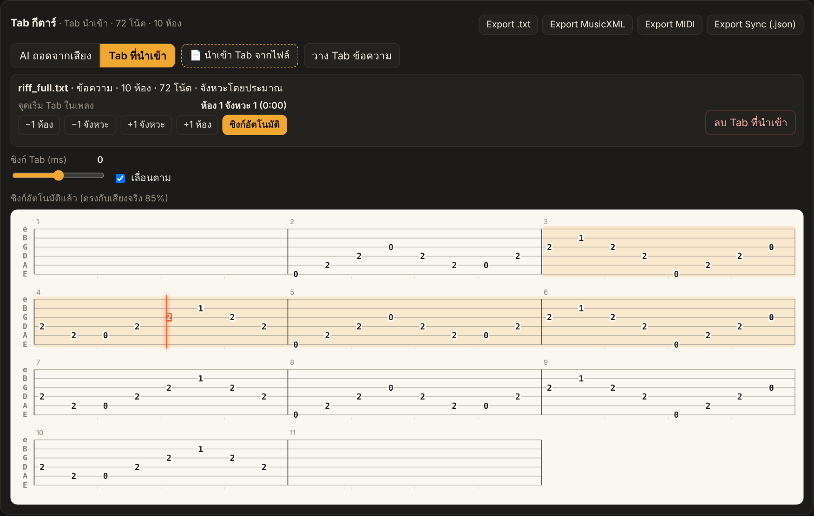

# 🎸 Guitar Stem Studio

**English** · [ภาษาไทย](README.th.md)

A local web app for guitar practice. Drop in an MP3 or paste a YouTube link. AI splits the song into 6 stems (guitar, vocals, drums, bass, piano, other) and transcribes the guitar into a tab that scrolls with the music. From there you can slow the song down, loop a section, practice with a metronome, or export a backing track without the guitar.

Everything runs on your own machine. No audio is uploaded anywhere (except the YouTube download itself).


## Features

| | |
|---|---|
| **Stem separation** | 6 stems with [Demucs](https://github.com/facebookresearch/demucs) `htdemucs_6s`. Each stem can be downloaded. |
| **Mixer** | Per-stem volume, mute and solo. One-click presets: *All*, *Guitar only* and *No guitar (backing)*. |
| **Slow down** | 25%–150% playback speed with pitch preserved. |
| **A–B loop** | Set A/B with buttons or `[` `]`, or Shift-click measures in the tab. |
| **Metronome** | Follows the song's real beats (beat tracking, snapped onto the drum hits), or a fixed BPM. Choose beats per bar and an optional 1-bar count-in. |
| **Synced tab** | AI transcription with [basic-pitch](https://github.com/spotify/basic-pitch), placed on strings and frets with a hand-movement-minimizing algorithm. The tab has a live cursor and highlights the notes being played. Click a note to seek. |
| **Import existing tabs** | PDF, Guitar Pro (`.gp3/.gp4/.gp5`), MusicXML (`.musicxml/.mxl`), `.txt`, or pasted text. **Auto-sync** lines the imported tab up with the audio. |
| **Tab export** | ASCII `.txt`, **MusicXML** (opens in MuseScore, Guitar Pro and TuxGuitar), MIDI, and a sync JSON with the time, string and fret of every note. |
| **Backing track export** | Pick stems and a time range (or use the A–B loop), set the speed, add a count-in and an optional metronome, then download MP3/WAV. Clicks are compensated for time-stretch latency so they land on the drums. |
| **YouTube / YouTube Music** | Paste a link and the song is downloaded and processed automatically ([yt-dlp](https://github.com/yt-dlp/yt-dlp), bundled ffmpeg). |

### Library: upload an MP3 or paste a YouTube link


### AI-transcribed tab, synced to the song


### Imported tab (PDF / Guitar Pro / MusicXML / text) with auto-sync


### Backing track export


<details>
<summary>Mobile layout</summary>


</details>

> The UI is currently in Thai.

## Install

Requires **Python 3.10 – 3.13** (3.11 or 3.12 recommended).

```bash
git clone https://github.com/un4ckn0wl3z/guitar-stem-studio.git
cd guitar-stem-studio
```

| | First-time setup | Run |
|---|---|---|
| **Windows** | double-click `setup.bat` | `run.bat` |
| **macOS / Linux** | `./setup.sh` | `./run.sh` |

Then open **http://localhost:8000**.

- The first separation downloads the Demucs model (~80 MB).
- On CPU, a 4-minute song takes roughly 3–8 minutes. An NVIDIA GPU is much faster: install the CUDA build of PyTorch from [pytorch.org](https://pytorch.org/get-started/locally/).
- YouTube changes often. If downloads start failing, run `update.bat` / `./update.sh`.

<details>
<summary>Manual install</summary>

```bash
python -m venv .venv
source .venv/bin/activate          # Windows: .venv\Scripts\activate
pip install -r requirements.txt
pip install --no-deps basic-pitch==0.4.0   # uses ONNX runtime instead of TensorFlow
python app.py
```
</details>

## Importing tabs

| Source | Accuracy |
|---|---|
| Guitar Pro `.gp3/.gp4/.gp5`, MusicXML | ⭐⭐⭐ Exact notes, rhythm and repeats |
| PDF exported from notation software | ⭐⭐ Strings and frets are exact; rhythm is estimated from spacing |
| ASCII tab (`e|--0--3--|`) in PDF, `.txt` or pasted | ⭐⭐ Strings and frets are exact; rhythm is estimated |
| Scanned or photographed PDF | ❌ Not supported (no OCR) |

Guitar Pro 6/7/8 files (`.gpx`/`.gp`) are not supported directly. Export them to `.gp5` or MusicXML first.

Auto-sync slides the imported tab across the AI transcription and picks the offset where the most notes agree. You can fine-tune it with the ±bar / ±beat buttons.

## Keyboard shortcuts

`Space` play/pause · `← →` ±5 s · `[` `]` set A/B · `L` toggle loop · `M` metronome · `-` `+` speed

## Configuration

| Env var | Default | |
|---|---|---|
| `GS_PORT` | `8000` | Port |
| `GS_HOST` | `127.0.0.1` | Set to `0.0.0.0` to use the app from a phone on the same LAN |
| `GS_DEVICE` | auto | `cuda` / `cpu` |
| `GS_STEM_FORMAT` | `mp3` | `wav` for lossless stems |
| `GS_MAX_MINUTES` | `20` | Maximum YouTube video length |
| `GS_DATA_DIR` | `./data/jobs` | Where songs and stems are stored |

## Project layout

```
app.py          FastAPI server + REST API
processing.py   Pipeline: download → Demucs separation → beat tracking → basic-pitch transcription
tabgen.py       Notes → string/fret assignment
tabimport.py    PDF / Guitar Pro / MusicXML / ASCII tab importers
backing.py      Backing-track renderer (mix, time-stretch, count-in, metronome)
static/         Web UI (vanilla JS, Web Audio)
```

## Notes

- Auto-transcribed tabs are a starting point, not a finished tab. Clean single-note guitar transcribes much better than heavy distortion or dense chords. For the best result, import a real tab.
- Use this for personal practice with music you have the right to use. Downloading from YouTube may be against YouTube's Terms of Service.

## Credits

[Demucs](https://github.com/facebookresearch/demucs) · [basic-pitch](https://github.com/spotify/basic-pitch) · [librosa](https://librosa.org) · [yt-dlp](https://github.com/yt-dlp/yt-dlp) · [pdfplumber](https://github.com/jsvine/pdfplumber) · [PyGuitarPro](https://github.com/Perlence/PyGuitarPro) · [FastAPI](https://fastapi.tiangolo.com)
