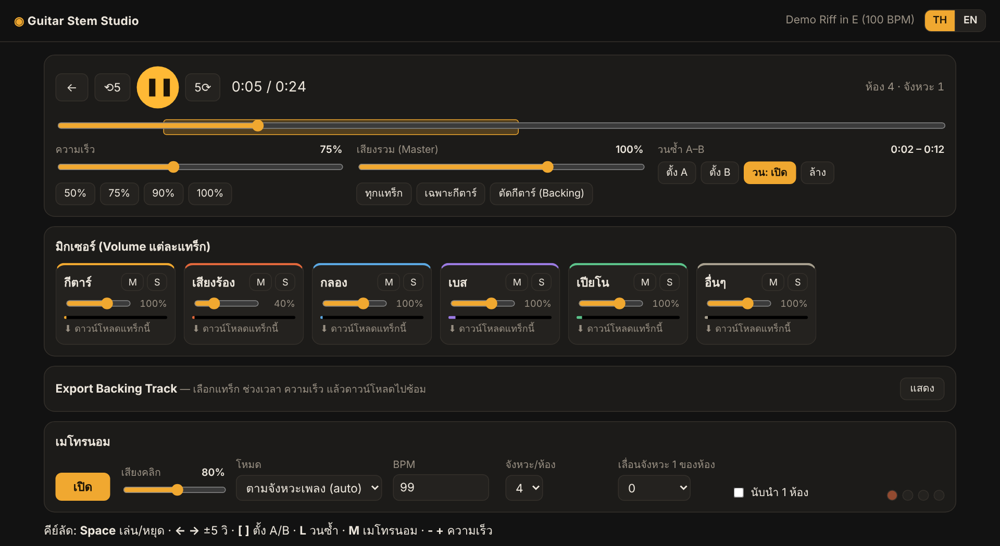
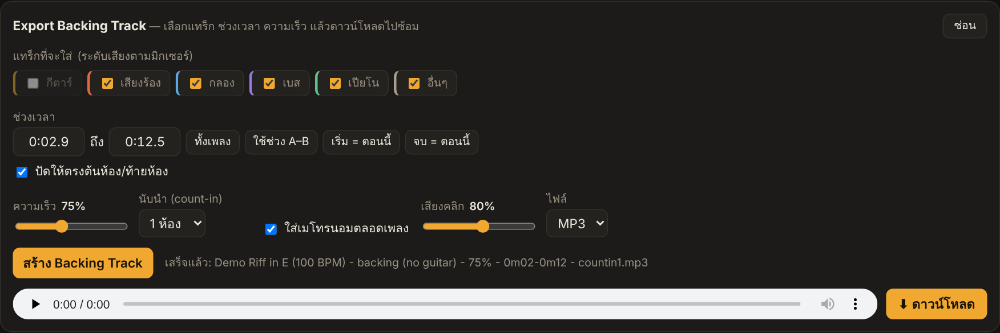

# 🎸 Guitar Stem Studio (ภาษาไทย)

[English](README.md) · **ภาษาไทย**



โปรแกรมช่วยซ้อมกีตาร์กับเพลงจริง ใส่ไฟล์ MP3 หรือวางลิงก์ YouTube แล้ว AI จะแยกเพลงเป็น 6 แทร็ก (กีตาร์ / เสียงร้อง / กลอง / เบส / เปียโน / อื่นๆ)
ปิดเสียงกีตาร์แล้วเล่นเองได้ ปรับช้าลง วนซ้ำท่อน ใส่เมโทรนอมที่ตามจังหวะเพลง และ export backing track ไปซ้อม
ทำงานบนเครื่องตัวเอง 100% ผ่านหน้าเว็บ (ไม่ต้องอัปโหลดเพลงขึ้นเน็ต)

## ดาวน์โหลดแบบพร้อมใช้ (ไม่ต้องลง Python)

ดาวน์โหลดจาก **[Releases](https://github.com/un4ckn0wl3z/guitar-stem-studio/releases/latest)**

| เครื่อง | ไฟล์ |
|---|---|
| Windows 10/11 (64-bit) | `GuitarStemStudio-windows-x64.zip` |
| Mac ชิป Apple (M1–M4) | `GuitarStemStudio-macos-arm64.zip` |
| Mac ชิป Intel | `GuitarStemStudio-macos-x64.zip` (ถ้ามี) |

1. แตกไฟล์ zip แล้วเปิด **GuitarStemStudio** ในโฟลเดอร์ เบราว์เซอร์จะเปิดให้เอง เปิดหน้าต่างดำทิ้งไว้ระหว่างใช้งาน ปิดหน้าต่างนั้นเมื่อจะเลิกใช้
2. ตัวโปรแกรมยังไม่ได้เซ็นรับรอง ครั้งแรกจะมีคำเตือน:
   - **Windows**: ขึ้น *"Windows protected your PC"* → กด **More info → Run anyway**
   - **Mac**: เปิด Terminal แล้วรันคำสั่งนี้ครั้งเดียว จากนั้นดับเบิลคลิก `GuitarStemStudio`
     ```bash
     xattr -dr com.apple.quarantine ~/Downloads/GuitarStemStudio
     ```
3. เพลงแรกที่ประมวลผล โปรแกรมจะดาวน์โหลดโมเดล AI (~80 MB)

ตัวพร้อมใช้ประมวลผลด้วย CPU ถ้าต้องการใช้การ์ดจอ NVIDIA ให้ติดตั้งจาก source ตามด้านล่าง

## ฟีเจอร์
- **เลือกภาษาได้ ไทย / อังกฤษ** — กดปุ่ม **TH / EN** มุมขวาบน (จำค่าไว้ให้ ครั้งแรกจะเลือกตามภาษาของเบราว์เซอร์)
- **วางลิงก์ YouTube / YouTube Music** แล้วโหลดเพลงเป็น MP3 ให้อัตโนมัติ (ใช้ yt-dlp + ffmpeg ที่ติดมากับโปรแกรม ไม่ต้องติดตั้งเพิ่ม)
- **แยกเสียง 6 แทร็ก** ด้วย AI (Demucs `htdemucs_6s`) — ดาวน์โหลดแต่ละแทร็กเป็นไฟล์ได้
- **มิกเซอร์**: ปรับ Volume ทีละแทร็ก, Mute / Solo, ปุ่มลัด "เฉพาะกีตาร์" / "ตัดกีตาร์ (Backing track)"
- **Slow down** 25%–150% โดยเสียงไม่เพี้ยน (pitch คงเดิม)
- **วนซ้ำ A–B**
- **เมโทรนอม**: ตามจังหวะเพลงอัตโนมัติ (จับตรงกับเสียงกลองจริง) หรือกำหนด BPM เอง, เลือกจังหวะ/ห้อง, เลื่อนจังหวะ 1, นับนำ 1 ห้อง
- **Export Backing Track**: เลือกแทร็กที่จะใส่ (ค่าเริ่มต้น = ทุกแทร็กยกเว้นกีตาร์), เลือกช่วงเวลา (หรือใช้ช่วง A–B), ปรับความเร็ว, ใส่นับนำ 1–2 ห้อง และ/หรือเมโทรนอมตลอดเพลง → ดาวน์โหลด MP3/WAV (คลิกตรงกับกลองแม้ปรับช้า)



## ติดตั้งจาก source (ครั้งแรกครั้งเดียว)
ต้องมี **Python 3.10 – 3.13** (แนะนำ 3.11/3.12) — ดาวน์โหลดที่ python.org

**Windows**: ดับเบิลคลิก `setup.bat`
**macOS / Linux**: `./setup.sh`

> ครั้งแรกที่แยกเสียง โปรแกรมจะดาวน์โหลดโมเดล AI (~80 MB) อัตโนมัติ

## ใช้งาน
**Windows**: `run.bat`  · **macOS / Linux**: `./run.sh`
แล้วเปิด http://localhost:8000 → ลากไฟล์ MP3 ใส่ **หรือวางลิงก์ YouTube แล้วกด "โหลดเพลง"** → รอประมวลผล → กด "เปิด"

> ถ้าโหลดจาก YouTube แล้วขึ้น error ทั้งที่ลิงก์ถูก (YouTube เปลี่ยนระบบบ่อย) ให้รัน `update.bat` / `./update.sh` เพื่ออัปเดตตัวโหลด
> จำกัดความยาววิดีโอ 20 นาที (เปลี่ยนได้ด้วย `GS_MAX_MINUTES`) · โปรดใช้กับเพลงที่คุณมีสิทธิ์ใช้งาน/เพื่อการซ้อมส่วนตัว

เวลาประมวลผล: เพลง 4 นาทีใช้ประมาณ 3–8 นาทีบน CPU (มีการ์ดจอ NVIDIA จะเร็วกว่ามาก)

### ขั้นตอนซ้อมที่แนะนำ
1. เปิดเพลง → กด **ตัดกีตาร์ (Backing)**
2. ตั้ง A–B รอบท่อนที่จะซ้อม → ลดความเร็วเหลือ 50–75%
3. เปิดเมโทรนอม (+ นับนำ 1 ห้อง)
4. คล่องแล้วค่อยเพิ่มความเร็ว หรือกด **Export Backing Track** เอาไปซ้อมนอกคอม

### คีย์ลัด
`Space` เล่น/หยุด · `← →` ±5 วิ · `[` `]` ตั้ง A/B · `L` เปิด/ปิดวนซ้ำ · `M` เมโทรนอม · `-` `+` ความเร็ว

## ตั้งค่าขั้นสูง (environment variables)
| ตัวแปร | ค่าเริ่มต้น | ความหมาย |
|---|---|---|
| `GS_PORT` | 8000 | พอร์ต |
| `GS_HOST` | 127.0.0.1 | ตั้ง `0.0.0.0` เพื่อเปิดจากมือถือในวง LAN เดียวกัน |
| `GS_DEVICE` | auto | `cuda` / `cpu` |
| `GS_STEM_FORMAT` | mp3 | `wav` ถ้าต้องการคุณภาพเต็ม |
| `GS_MAX_MINUTES` | 20 | ความยาวสูงสุดของวิดีโอที่โหลดจาก YouTube |
| `GS_DATA_DIR` | ./data/jobs | ที่เก็บไฟล์ |

**ใช้การ์ดจอ NVIDIA**: ติดตั้ง torch แบบ CUDA ตาม https://pytorch.org/get-started/locally/ หลัง setup

## โครงสร้าง
```
launcher.py     ตัวเปิดโปรแกรมแบบพร้อมใช้ (เลือกโฟลเดอร์เก็บเพลง, พอร์ต, เปิดเบราว์เซอร์)
app.py          เว็บเซิร์ฟเวอร์ (FastAPI)
processing.py   โหลด YouTube + แยกเสียง (Demucs) + หาจังหวะ (librosa, จับตรงเสียงกลอง)
backing.py      สร้างไฟล์ Backing Track (มิกซ์ + ยืดเวลา + count-in + เมโทรนอม)
i18n.py         รหัสข้อความ/ข้อผิดพลาดที่ส่งให้หน้าเว็บแปลภาษา
static/         หน้าเว็บ (เล่นเพลง, มิกเซอร์, เมโทรนอม, Export) — คำแปลอยู่ใน static/i18n.js
```

## ออกเวอร์ชันใหม่ (Release)
push tag แล้ว GitHub Actions จะ build ตัว Windows + Mac และสร้าง Release ให้อัตโนมัติ
```bash
git tag v1.0.0
git push origin v1.0.0
```
